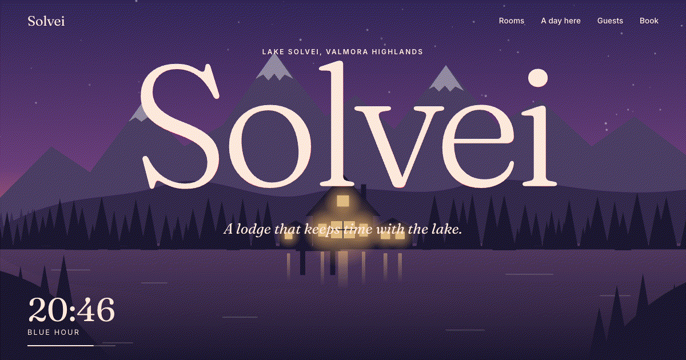

# Scrollcraft Travel

A free, static, scroll-driven website template for a hotel or travel resort. Scroll works as a playhead: the hero passes a full day from sunrise to night, the camera flies through a lit window into a room, rooms slide past on a pinned rail and open into a full detail view, a route draws itself around the lake, and the page ends with a booking widget that sends a prefilled request over WhatsApp or email.

The demo brand, **Solvei Lake Lodge**, is fictional. Everything about it lives in one file, `src/content.json`, so you can rebrand the whole site without touching any logic.

**Live demo:** LIVE_URL



## Features

- **Day to night hero.** A hand-built SVG landscape (sky, sun and moon arcs, stars, three mountain layers with parallax, lake reflections, a lodge whose windows light up). Colours, the clock and the text colour are interpolated from keyframes in `content.json`.
- **Fly-through.** The camera zooms into the lodge's picture window by animating the SVG `viewBox`, so the art stays sharp at any zoom. The interior fades in when the glass fills the screen.
- **Pinned horizontal room rail** with inner parallax on each card.
- **Shared-element room detail.** The card image morphs into the detail view with GSAP Flip and morphs back on close. The detail is a native `<dialog>` with a gallery, amenities, price per night and a "Book this room" button that preselects the room in the booking form.
- **Itinerary map.** The route draws itself on scroll, markers are placed along the path from each stop's `at` value, and the matching stop card is shown.
- **Guest reviews** with a word-by-word scroll reveal.
- **Booking widget.** Dates, guests and room give nights × price, cleaning fee, taxes and an estimated total, all client-side. Requests open WhatsApp (`wa.me`) or the visitor's email app with every detail filled in. No backend and no API keys.
- **Generated room art.** Each room gets three illustrations (bedroom, bath, terrace) drawn in SVG from its colour palette. If you add photo paths, the photos are used instead.
- **Accessible and fast.** Semantic HTML, real buttons, a skip link, alt text on all art, and focus handling in the dialog. Full `prefers-reduced-motion` fallback with no smooth scroll, pins or morphs. No raster images in the page itself, fonts are self-hosted, and the JS is about 75 kB gzipped.

## Stack

Vite, TypeScript (vanilla, no framework), GSAP with ScrollTrigger and Flip, Lenis smooth scroll, and Fontsource (Fraunces and Inter).

## Run it

```bash
pnpm install
pnpm dev        # local dev server
pnpm build      # type-check and build to dist/
pnpm preview    # serve the production build
```

Deploy `dist/` to any static host. On Vercel, the default Vite preset works with no config.

## Customise `src/content.json`

| Key | What it controls |
| --- | --- |
| `brand` | Name, full name, tagline, meta description, location, coordinates. These are also injected into `<title>` and the social meta tags at build time. |
| `contact` | `whatsapp` (international format, digits only), `email`, the phone number shown on the page, and the address. |
| `theme` | Page colours. Each key becomes a CSS variable, so `paperDeep` becomes `--paper-deep`. |
| `nav` | Top navigation links. |
| `hero.phases` | Time-of-day keyframes. `at` is scroll progress from 0 to 1. Each phase sets the sky, mountain, water and text colours, how lit the windows are (`windows`), and star visibility (`stars`). The clock shows times interpolated between phases. |
| `arrival` | The copy shown after the fly-through. |
| `rooms.items` | Rooms: `name`, `short`, `description`, `price`, `size`, `sleeps`, `bed`, `view`, `amenities`, and a `palette` for the generated art. Add `images: ["/rooms/cabin-1.webp", ...]` to use photos from `public/` instead. |
| `rooms.currencySymbol` | The currency symbol used across the site. |
| `day.stops` | Itinerary stops. `at` (0 to 1) is the stop's position along the route. |
| `reviews` | The featured quote, the quote cards and the rating line. |
| `booking` | Cleaning fee, tax rate, labels, and minimum and maximum nights. |
| `footer` | Footer copy. |

To change the landscape itself (mountain shapes, lodge, window positions), edit `src/render/scene.ts`. The window the camera flies into is `TARGET_WINDOW`.

## Project structure

```
src/
  content.json        all copy, prices, colours and contact details
  content.ts          types for content.json and the money formatter
  booking.ts          price calculation and WhatsApp / mailto links
  render/             HTML and SVG string builders (page, scene, room art)
  motion/             one module per scroll moment (hero, rail, detail, day, reveals, nav, smooth)
  lib/phase.ts        keyframe sampling for the day-to-night colours
```

## Credits

- All illustrations are original SVG made for this template. No stock photos or video are used.
- Fonts: [Fraunces](https://fonts.google.com/specimen/Fraunces) and [Inter](https://rsms.me/inter/) (SIL Open Font License), self-hosted via [Fontsource](https://fontsource.org).
- Motion: [GSAP](https://gsap.com) (free under the GSAP standard license) and [Lenis](https://lenis.darkroom.engineering) (MIT).

## License

MIT. See [LICENSE](LICENSE). Solvei Lake Lodge, its rooms, reviews and contact details are fictional.
