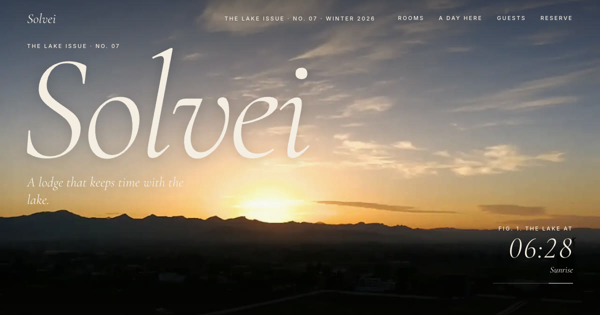

# Scrollcraft Travel

A free, static, scroll-driven website template for a hotel or travel resort, art-directed as a printed travel magazine: quiet luxury, paper and ink, Cormorant Garamond italics, folios, captions and drop caps. Scroll works as a playhead. A real time-lapse carries the hero from first light through sunrise, afternoon and sunset into blue hour. The camera then finds the lodge with its lights on, pushes in through the windows and lands in a room. Rooms turn past as magazine plates and open into a full spread, a route draws itself around the lake, and the issue closes with a concierge card that sends a prefilled reservation request over WhatsApp or email.

The demo brand, **Solvei Lake Lodge**, is fictional. Everything about it lives in one file, `src/content.json`, so you can rebrand the whole site without touching any logic.

**Live demo:** https://scrollcraft-travel.vercel.app



## Features

- **Real sunrise to sunset hero.** Two Pexels time-lapses (a sunrise over a mountain range and a sunset behind the hills of a lake) are stitched with a crossfade and cut into WebP frame sequences: 240 landscape frames for desktop (7.2 MB) and 160 portrait frames cropped around the sun for phones (3.3 MB), with the colour grade baked in at export. A canvas scrubs them with scroll, the clock reads the time of day from keyframes in `content.json`, and a blue-hour grade closes the day.
- **Smooth scrubbing.** `src/lib/sequence.ts` decodes a sliding window of frames around the playhead into `ImageBitmap`s off the main thread, so a draw never waits on a decode. The playhead is fractional and eased on the shared GSAP ticker, and neighbouring frames are cross-blended by the fraction, so the picture changes on every display frame instead of stepping. The canvas is sized only on resize and capped to the detail the footage actually has. Measured in headless Chrome while scrolling the hero, the picture updated 19 times a second before this (12.6 with 4x CPU throttling) and 59 times a second after.
- **Progressive frame loading.** The first frame ships as an `` poster, then frames stream in coarse to fine (every 16th, 8th, 4th, 2nd, then all) after the page is idle, so the full scroll range works early on slow connections.
- **Fly-through.** A slow crossfade to the lit lodge at dusk, then a camera push towards its windows (focus point set in `content.json`) and a crossfade into the room.
- **Rooms as magazine plates** on a pinned horizontal rail, staggered like a layout, with gentle inner parallax.
- **Shared-element room spread.** The plate morphs into a two-page spread with GSAP Flip (slow `expo.inOut`), with a captioned gallery, facts, amenities and a "Reserve this room" button that fills in the concierge card.
- **A day here.** A line-art map of the lake whose route draws itself on scroll. Markers are placed along the path from each stop's `at` value, and each stop shows its photograph.
- **Guests.** A pull quote that inks in word by word, then quotes set in hairline columns.
- **Concierge card.** The booking form reads as a letter ("Dear concierge, I would like to reserve the...") with inline fields, an account with dotted leaders (nights × rate, cleaning fee, taxes, total), and "Send by WhatsApp" or "Send by email" links filled in with every detail. Everything runs client-side, with no backend and no API keys.
- **Calm motion.** Lenis smooth scroll, long sine and expo eases, line-by-line heading reveals through masks (GSAP SplitText), and slow crossfades. Nothing bounces.
- **Accessible and light.** Semantic HTML, real buttons, alt text on every photograph, a native `<dialog>`, a skip link, and fixed aspect ratios so nothing shifts. With `prefers-reduced-motion`, the hero is a still sunset frame followed by the lodge and the room as plain plates, with no pins, morphs or smooth scroll.

## Stack

Vite, TypeScript (vanilla, no framework), GSAP (ScrollTrigger, Flip, SplitText), Lenis, and Fontsource (Cormorant Garamond and Inter).

## Run it

```bash
pnpm install
pnpm dev        # local dev server
pnpm build      # type-check and build to dist/
pnpm preview    # serve the production build
```

Deploy `dist/` to any static host. On Vercel, the default Vite preset works with no config.

## Customise `src/content.json`

| Key | What it controls |
| --- | --- |
| `brand` | Name, issue number, issue title, season, tagline, meta description, location. These are also injected into `<title>` and the social tags at build time. |
| `contact` | `whatsapp` (international format, digits only), `email`, the phone number shown on the page, and the address. |
| `theme` | Paper, ink and accent colours. Each key becomes a CSS variable (`paperDeep` becomes `--paper-deep`). |
| `hero.sequence` | The frame folders for desktop and mobile: path, frame count, digits and extension. |
| `hero.phases` | Clock keyframes. `at` is progress through the footage (0 to 1), with the time and label shown. |
| `hero.exterior`, `hero.interior` | Photos for the fly-through. `focus` is the point the camera pushes towards, as `[x, y]` fractions. |
| `rooms.items` | Rooms: name, copy, price, size, sleeps, bed, view, amenities and `images` (the first is the plate). If `images` is empty, an illustrated room is drawn from `palette` instead. |
| `day.stops` | Itinerary stops with `at` (position along the route), time, title, text and `image`. |
| `reviews`, `booking`, `footer` | Copy, fees and tax rate, labels and photographs. |

### Use your own footage

Any time-lapse works. To cut a sequence with ffmpeg and cwebp:

```bash
ffmpeg -i timelapse.mp4 -vf "fps=240/DURATION,scale=1280:720" frames/%03d.png
for f in frames/*.png; do cwebp -q 62 "$f" -o "public/seq/d/$(basename "${f%.png}").webp"; done
# portrait set for phones: crop a 9:16 window around the sun, then scale to 540x960
```

Then update `hero.sequence` and `hero.phases`.

## Project structure

```
src/
  content.json        all copy, prices, images, sequence settings and contact details
  content.ts          types for content.json and the money formatter
  booking.ts          price calculation and WhatsApp / mailto links
  lib/sequence.ts     progressive frame loader and canvas cover renderer
  lib/phase.ts        clock interpolation for the hero
  render/             HTML builders (page, room media with illustrated fallback)
  motion/             one module per scroll moment (hero, rail, detail, day, reveals, nav, smooth)
public/
  seq/d, seq/m        time-lapse frame sequences (desktop, mobile)
  img/                photographs (WebP)
```

## Credits

All footage and photographs come from [Pexels](https://www.pexels.com) under the [Pexels License](https://www.pexels.com/license/), which allows free commercial use without attribution. They are credited here anyway, with thanks to the photographers. They were downloaded, cropped and compressed to WebP for this template.

**Video**
- Sunrise time-lapse: [Beautiful Sunrise Time Lapse](https://www.pexels.com/video/beautiful-sunrise-time-lapse-5379825/)
- Sunset time-lapse: [Time Lapse of a Sunset by the Lake](https://www.pexels.com/video/time-lapse-of-a-sunset-by-the-lake-9564200/)

**Photographs** (Pexels photo IDs, each at `https://www.pexels.com/photo/<id>/`)
- Lodge at dusk: [28271971](https://www.pexels.com/photo/28271971/) (eberhard grossgasteiger)
- A-frame interior: [19737838](https://www.pexels.com/photo/19737838/)
- Lakeside Cabin: [19737839](https://www.pexels.com/photo/19737839/), [5604254](https://www.pexels.com/photo/5604254/), [547114](https://www.pexels.com/photo/547114/)
- Pine Loft: [16747776](https://www.pexels.com/photo/16747776/), [10560268](https://www.pexels.com/photo/10560268/), [14945914](https://www.pexels.com/photo/14945914/)
- Alpenglow Suite: [775219](https://www.pexels.com/photo/775219/), [105934](https://www.pexels.com/photo/105934/), [30835932](https://www.pexels.com/photo/30835932/)
- Boathouse Studio: [10530007](https://www.pexels.com/photo/10530007/), [29953197](https://www.pexels.com/photo/29953197/), [15953852](https://www.pexels.com/photo/15953852/)
- Summit Chalet: [9056661](https://www.pexels.com/photo/9056661/), [3551230](https://www.pexels.com/photo/3551230/), [29887320](https://www.pexels.com/photo/29887320/)
- A day here: [4034973](https://www.pexels.com/photo/4034973/), [5720803](https://www.pexels.com/photo/5720803/), [2387876](https://www.pexels.com/photo/2387876/) (Sam Kolder), [8929569](https://www.pexels.com/photo/8929569/), [4992827](https://www.pexels.com/photo/4992827/), [2605867](https://www.pexels.com/photo/2605867/)
- Supper table: [4989546](https://www.pexels.com/photo/4989546/). Night sky: [18780512](https://www.pexels.com/photo/18780512/)

Fonts: [Cormorant Garamond](https://fonts.google.com/specimen/Cormorant+Garamond) and [Inter](https://rsms.me/inter/) (SIL Open Font License) via [Fontsource](https://fontsource.org). Motion: [GSAP](https://gsap.com) (free standard license) and [Lenis](https://lenis.darkroom.engineering) (MIT).

## Author

Designed and built by [Muhammad Izhar](https://izhar.dev). Change `credits` in `content.json` to put your own name in the footer.

## License

The code is MIT; see [LICENSE](LICENSE). Photographs and footage stay under the Pexels License. Solvei Lake Lodge, its rooms, reviews and contact details are fictional.
